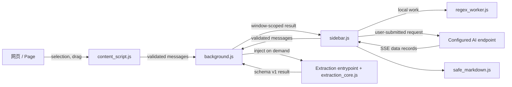

# 架构说明 / Architecture

[中文](#中文) · [English](#english)

<a id="中文"></a>

## 中文

### 设计概览

Smart Sidebar Assistant 是一个无构建步骤的 Chrome Manifest V3 扩展。后台 Service Worker 负责权限边界、标签页操作和任务恢复；侧边栏负责界面与 AI 请求；内容脚本只处理页面选区和链接拖放；所有页面提取都经过统一的结构化契约。



### 运行模块

| 模块 | 职责 |
| --- | --- |
| `manifest.json` | 声明 Chrome 120+、权限、后台、侧边栏、设置页和内容脚本 |
| `background.js` | 校验消息发送者、解析目标标签页、注入提取器、校验提取契约、管理右键菜单与链接任务 |
| `content_script.js` | 经后台授权后捕获选区；创建隔离在 closed ShadowRoot 中的链接拖放预览 |
| `sidebar.js` | 主界面、聊天和引用、API 请求队列、SSE 解析、正则工具、链接任务领取/确认 |
| `options.js` | API 配置、活动配置、语言和高级正则设置、连接测试 |
| `prompts.js` | 预设与自定义 Prompt 模板 |
| `archive.js` | 存档列表、存档内继续对话与持久化 |
| `extraction_core.js` | 统一 `visible`、`reader`、`both` 三种提取模式和 schema v1 结果 |
| `*_content_extractor.js` | 注入页面的轻量入口，分别选择提取模式 |
| `regex_engine.js` / `regex_worker.js` | 可测试的纯正则逻辑与浏览器 Worker 隔离 |
| `libs/safe_markdown.js` | 对模型 Markdown 生成的 DOM 做标签、属性和 URL 白名单清洗 |

旧版 popup 与未使用的内容脚本已从发布源中移除；商店包由显式 allowlist 生成，不包含测试、文档站开发文件或系统元数据。

### 提取契约

四个入口复用同一核心：

| 入口 | 模式 | 用途 |
| --- | --- | --- |
| `page_content_extractor.js` | `visible` | 提取可见 `body.innerText` 作为本地引用 |
| `reader_content_extractor.js` | `reader` | 当前页总结；Readability 失败时回退可见文本 |
| `regex_content_extractor.js` | `both` | 同时提供正文和完整可见文本供正则选源 |
| `link_content_extractor.js` | `reader` | 临时标签页中的链接正文提取 |

提取结果固定使用 `schemaVersion: 1`，核心字段为 `ok`、`source`、`extraction`、`content`、`metadata`、`warnings` 和 `error`。后台在结果跨越注入边界后再次检查对象结构、文本长度和 `charCount`，不能把未经验证的页面返回值直接交给侧边栏。

Readability 处理克隆后的文档，保留段落、块元素、`<br>`、表格单元格等文本边界。超过 DOM 上限、Readability 不可用或解析失败时会产生结构化 warning，并在可用时回退到可见文本。

### 主要数据流

1. **当前页总结**：侧边栏确定窗口/标签页 → 后台验证侧边栏发送者和标签页归属 → 注入 Readability、核心和 reader 入口 → 返回经过校验的结果 → 侧边栏使用隔离于既有聊天历史的摘要请求调用当前 AI 服务 → 清洗模型 Markdown 后显示。
2. **本地全文引用**：侧边栏请求 `visible` 提取 → 文本只进入引用区。只有用户之后点击发送时，该引用才进入 AI 请求。
3. **正则提取**：后台以 `both` 模式返回正文和可见全文 → 侧边栏按设置选源并做 180 ms 防抖 → 一次性 Worker 执行 → 超过 1 秒直接终止 Worker。预览和复制不调用 AI。
4. **选区捕获**：内容脚本先询问 `shouldCaptureSelection`；后台只在同一窗口存在已注册侧边栏端口时授权，内容脚本才读取并转发选区。
5. **图片分析**：右键动作把图片 URL 交给侧边栏；侧边栏限时下载并检查大小，然后把图片数据发送给当前配置。是否可分析取决于所选模型和兼容接口是否支持图片输入。

### 链接任务生命周期

链接拖放或右键菜单会创建一个窗口级任务。后台先设置超时 alarm 并持久化 `creating` 状态，再打开非活动临时标签页：

```text
creating → loading → extracting → completed
                              ↘ failed
```

页面完成后有 400 ms 的短暂稳定窗口。任务进入终态后，后台关闭临时标签页并通知发起窗口。终态任务先进入当前侧边栏实例的串行 API 队列；轮到它取得执行槽时，侧边栏才请求 claim 租约：

```text
claim → AI 成功且响应非空 → ack → 删除记录
claim → 交付失败          → release → retryAfter → 再次可领取
```

后台重启时会从 `chrome.storage.session` 恢复未结束任务；alarm 负责提取超时、租约/重试唤醒和终态清理。状态与存储写入均经过串行锁，避免并发领取、超时或清理相互覆盖。

### 存储模型

| 位置 | 数据 | 生命周期与注意事项 |
| --- | --- | --- |
| `chrome.storage.sync` | `apiConfigurations`（包含 API Key）、`activeConfigurationId`、`interfaceLanguage`、高级正则设置 | 可由 Chrome 在登录同一账户的浏览器间同步；开发者服务器不参与 |
| `chrome.storage.local` | `gExtensionConversationIndex:v1:*`、`gExtensionConversation:v1:*`、`promptTemplates` | 后台单写者按会话独立保存，避免多窗口整数组覆盖；普通聊天最多 50 个、存档最多 200 个，单会话 512 KiB、每类总预算 7 MiB；首次读取自动迁移旧键 |
| `chrome.storage.session` | `gExtensionLinkJob:*` 与紧凑索引 | 临时链接任务，用于 Service Worker/侧边栏恢复；完成约 10 分钟后尝试清理，有效 claim/retry 会延期，ack 成功则立即删除 |
| 内存 | API 串行队列、当前界面状态、已连接侧边栏窗口计数 | 扩展页面或 Service Worker 结束后消失 |

### 信任边界

- 后台分别维护侧边栏动作和内容脚本动作 allowlist，并检查扩展 ID、发送页面、顶层 frame、标签页和窗口归属。
- 链接只接受无内嵌凭据的 `http:`/`https:` URL；当前页提取可按需处理 `file:`，前提是用户授予 Chrome 的文件访问权限。
- 页面正文属于不可信输入。摘要请求不携带既有聊天历史，并附加“把网页内容视为数据”的安全指令。
- 模型输出不是可信 HTML。`safe_markdown.js` 在展示前清洗危险标签、事件属性、样式和不安全 URL scheme。
- 正则运行在可终止的 Worker 中；拖放界面位于 closed ShadowRoot；扩展运行脚本均从包内加载。
- `<all_urls>` 提供访问能力，但不会自动发送内容。只有明确的 AI 操作才会把对应数据发往用户配置的服务。

### 资源边界

| 项目 | 上限/超时 |
| --- | ---: |
| Readability 预检 | 50,000 个 DOM 元素 |
| 每个提取文本字段、选区和正则源文本 | 200,000 字符 |
| 正则表达式 | 10,000 字符 |
| 正则输出 | 1,000 次命中、100,000 个结果字符、1 秒 Worker 超时 |
| 发往 AI 的单次源文本 | 120,000 字符 |
| 普通聊天历史 | 最近 40,000 字符 |
| 图片 | 10 MiB，下载 30 秒超时 |
| 侧边栏/存档页流式 AI 请求 | 总计 2 分钟；流连续 30 秒无数据即终止 |
| 链接提取 | 最多 3 个并发；每个 30 秒 |
| 链接任务 session 预算 | 7 MiB；每个活动任务预留 900 KiB |
| 链接 claim / 重试 / 终态清理 | 5 分钟 / 60 秒 / 完成约 10 分钟后尝试；有效 claim/retry 会延期 |

<a id="english"></a>

## English

### Overview

Smart Sidebar Assistant is a build-free Chrome Manifest V3 extension. The background service worker owns permission checks, tab operations, extraction injection, and recoverable link jobs. The side panel owns UI and AI requests. The content script is limited to selection capture and link dragging. Every injected extraction crosses a validated schema-v1 boundary.

### Runtime components

| Component | Responsibility |
| --- | --- |
| `manifest.json` | Declares Chrome 120+, permissions, the service worker, side panel, options page, and content script |
| `background.js` | Validates senders, resolves tabs, injects extractors, validates results, manages context menus and link jobs |
| `content_script.js` | Captures selections after authorization and hosts the link preview in a closed ShadowRoot |
| `sidebar.js` | UI, chat/quotes/images, serialized API requests, SSE parsing, regex UI, and link-job delivery |
| `options.js`, `prompts.js`, `archive.js` | Settings, prompt-template management, and archived conversations |
| `extraction_core.js` | Shared `visible`, `reader`, and `both` extraction contract |
| `regex_engine.js`, `regex_worker.js` | Pure regex logic and disposable Worker isolation |
| `libs/safe_markdown.js` | Tag, attribute, and URL allowlist sanitization for rendered model output |

The obsolete popup and unused content script were removed. Store packages are generated from an explicit allowlist and exclude tests, documentation-development files, and operating-system metadata.

### Extraction and user flows

- `page_content_extractor.js` uses `visible` mode for a local quote.
- `reader_content_extractor.js` uses Readability with visible-text fallback for current-page summaries.
- `regex_content_extractor.js` uses `both` mode so the user can choose reader text or full visible text.
- `link_content_extractor.js` uses reader mode inside an inactive temporary tab.

The result contains `schemaVersion`, `ok`, `source`, `extraction`, `content`, `metadata`, `warnings`, and `error`. The background validates structure, lengths, and `charCount` after injection. Readability runs on a document clone and preserves block and line boundaries; a structured warning accompanies any fallback.

Current-page summaries exclude existing chat history and treat page content as untrusted data. Full visible-text extraction remains local until the user sends the quote. Regex preview/copy runs locally in a disposable Worker. Selection text is read only after the background confirms that a side panel is connected in the same window. Image data is fetched and sent only after the user invokes image analysis, and the active model must support image input.

### Recoverable link jobs

A link action persists a `creating` job and timeout alarm before opening an inactive tab. The state path is `creating → loading → extracting → completed | failed`. A terminal job first enters the current side-panel instance's serial API queue and requests a window-scoped claim only after it owns the execution slot. A successful non-empty AI response is acknowledged and removes the record; a failed delivery releases the claim and schedules a retry. Session storage and alarms allow recovery after service-worker suspension.

### Storage and trust boundaries

| Storage | Contents |
| --- | --- |
| `chrome.storage.sync` | API configurations including keys, active configuration, language, and advanced regex settings |
| `chrome.storage.local` | Per-conversation indexed chat/archive records and prompt templates; background serialization prevents multi-window lost updates. Ordinary chat is capped at 50 records, archives at 200, each record at 512 KiB, and each store at 7 MiB; legacy array keys migrate on first read |
| `chrome.storage.session` | Link-job records and compact index for recovery |

Privileged messages use separate side-panel and content-script action allowlists plus sender, frame, tab, and window validation. Link targets must be credential-free HTTP(S) URLs. Page content is untrusted, model Markdown is sanitized, regex work is terminable, and packaged runtime scripts are local. `<all_urls>` grants access but does not itself transmit data.

### Current resource limits

| Area | Limit |
| --- | ---: |
| Readability preflight | 50,000 DOM elements |
| Extracted fields, selection, regex source | 200,000 characters each |
| Regex pattern/output | 10,000 pattern characters; 1,000 hits; 100,000 output characters; 1-second Worker timeout |
| AI-bound source/history | 120,000 / newest 40,000 characters |
| Image | 10 MiB; 30-second fetch timeout |
| Side-panel/archive streaming AI request | 2 minutes total; 30 seconds stream-idle |
| Link extraction | 3 concurrent; 30 seconds each |
| Link session budget | 7 MiB; 900 KiB reserved per active job |
| Link claim/retry/terminal cleanup | 5 minutes / 60 seconds / attempted about 10 minutes after completion; active claim/retry delays it |
